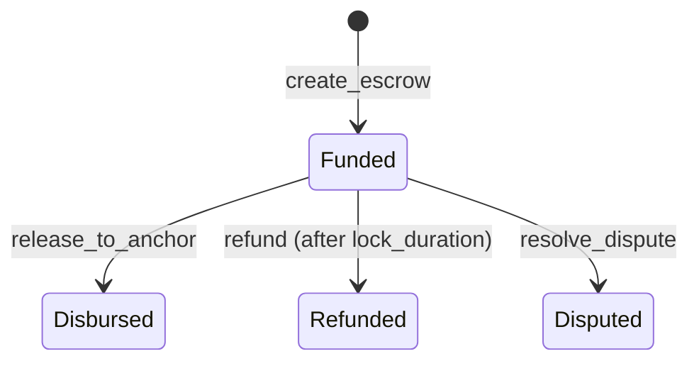

# Smart Contract Parity Specification

This document details the function, argument, type, event, and state parity between the authoritative Soroban contract natively maintained in [`contracts/`](../contracts/) and this application repository's layers (`apps/web`, `packages/contract-client`, `services/relay`).

---

## 1. Public Contract Functions & Signatures

| Function | Contract Arguments | TypeScript SDK Method (`packages/contract-client`) | Description |
|---|---|---|---|
| `init` | `admin: Address`, `treasury: Address`, `fee_bps: u32` | `buildInitTx({ admin, treasury, feeBps })` | Initializes contract admin, treasury, and fee basis points (0..10,000) |
| `create_escrow` | `payer: Address`, `beneficiary: Address`, `token: Address`, `amount: i128`, `lock_duration: u64`, `profile_hash: BytesN<32>` | `buildCreateEscrowTx({ payer, beneficiary, token, amount, lockDurationSeconds, profileHashHex })` | Locks token deposit in escrow with 32-byte profile commitment |
| `release_to_anchor` | `escrow_id: u64`, `caller: Address`, `anchor_disbursement_address: Address` | `buildReleaseToAnchorTx({ escrowId, caller, anchorDisbursementAddress })` | Releases escrow funds to anchor disbursement address |
| `refund` | `escrow_id: u64` | `buildRefundTx(escrowId)` | Refunds locked escrow to payer after lock duration expires |
| `resolve_dispute` | `escrow_id: u64`, `caller: Address`, `payer_bps: u32`, `beneficiary_bps: u32` | `buildResolveDisputeTx({ escrowId, caller, payerBps, beneficiaryBps })` | Mediates dispute by splitting funds between payer and beneficiary |
| `set_token_whitelist` | `caller: Address`, `token: Address`, `whitelisted: bool` | `buildSetTokenWhitelistTx({ caller, token, whitelisted })` | Admin controls asset whitelist for deposits |
| `is_token_whitelisted` | `token: Address` | `buildIsTokenWhitelistedTx(token)` | Queries whether a token address is approved for escrow deposits |
| `get_escrow` | `escrow_id: u64` | `buildGetEscrowTx(escrowId)` | Fetches the onchain escrow record by ID |

---

## 2. Onchain Escrow State Lifecycle

The smart contract uses four explicit state variants:



| State Variant | Description | UI Representation |
|---|---|---|
| `Funded` | Tokens locked in escrow contract | `Funded` |
| `Disbursed` | Escrow released to anchor for off-ramp payout | `Disbursed` |
| `Refunded` | Escrow returned to depositor after timelock | `Refunded` |
| `Disputed` | Escrow split and settled by designated arbiter | `Disputed` |

> ⚠️ **State Correction**: The app previously rendered `Funded → Disbursed → Settled`. The contract contains **no `Settled` variant**. The frontend status display strictly reflects `Funded → Disbursed → Refunded`.

---

## 3. Soroban Event Specification

| Contract Event Topic | Topic XDR Symbol | Payload Type | Relay Listener Topic (`services/relay`) |
|---|---|---|---|
| `disbursed` | `[Symbol("disbursed"), u64(escrow_id)]` | `(profile_hash: BytesN<32>, payout_amount: i128)` | `disbursed` |

> ⚠️ **Event Format**: The contract emits topic `["disbursed", escrow_id]` and tuple payload `(profile_hash, payout_amount)`. The Go relay listener decodes both the topic escrow ID and the payload profile hash and i128 payout amount into `*big.Int`.

---

## 4. Numeric & Data Domain Mapping

| Data Field | Contract Type | SDK / TypeScript Type | Go Relay Type | Boundary Enforcement |
|---|---|---|---|---|
| `amount` | `i128` | `bigint` (native bigint string/int) | `*big.Int` | Integer-safe conversion; no JS floating-point for transaction construction |
| `escrow_id` | `u64` | `bigint` | `uint64` | Native unsigned 64-bit integer |
| `lock_duration` | `u64` | `bigint` | `uint64` | Seconds |
| `profile_hash` | `BytesN<32>` | `string` (64-char hex / 32 bytes) | `[32]byte` | Strictly validated 32-byte SHA-256 digest |
| `fee_bps` | `u32` | `number` | N/A | Validated range `0 <= fee_bps <= 10000` |

---

## 5. Contract WASM Hash Parity

The deployed Soroban contract's on-chain WASM hash must match the SHA-256 of the
locally compiled release WASM bytecode. This guarantees that the contract running
on-chain is exactly the code reviewed and tested in this repository.

### Verification script

Use [`scripts/verify_contract_parity.sh`](../scripts/verify_contract_parity.sh) to
perform the comparison:

```bash
# Using flags
./scripts/verify_contract_parity.sh \
  --contract-id CBIHLECKLMXYK6FPHSGGVYF6AHNFRHR3T5EIFIS3PFQDFKDQWNR25PHT \
  --rpc-url https://soroban-testnet.stellar.org \
  --network testnet

# Using environment variables
export CONTRACT_ID=CBIHLECKLMXYK6FPHSGGVYF6AHNFRHR3T5EIFIS3PFQDFKDQWNR25PHT
export SOROBAN_RPC_URL=https://soroban-testnet.stellar.org
export NETWORK=testnet
./scripts/verify_contract_parity.sh
```

### Prerequisites

| Tool | Purpose |
|------|---------|
| `sha256sum` / `shasum` / `openssl` | Compute SHA-256 of local WASM |
| `curl` | Query Soroban RPC (fallback method) |
| `jq` | Parse RPC JSON responses |
| `stellar` or `soroban` CLI | Preferred method to fetch deployed WASM hash |
| `cargo` (with `wasm32-unknown-unknown`) | Build local release WASM (`--build` flag) |

### Expected output

On success:

```
[verify_contract_parity] Checking prerequisites...
[verify_contract_parity] Prerequisites OK (hash: sha256sum)
[verify_contract_parity] Computing local WASM hash: contracts/target/wasm32-unknown-unknown/release/soroban_anchor_escrow.wasm
[verify_contract_parity] Local WASM hash: a1b2c3d4...
[verify_contract_parity] Fetching deployed WASM hash via stellar CLI...
[verify_contract_parity] Deployed WASM hash (via stellar): a1b2c3d4...
[verify_contract_parity] Comparing hashes...
[verify_contract_parity]   Local  : a1b2c3d4...
[verify_contract_parity]   Deployed: a1b2c3d4...
[verify_contract_parity] ✅ Contract parity verified: local and deployed WASM hashes match.
```

On mismatch:

```
[verify_contract_parity] ❌ Contract parity MISMATCH:
[verify_contract_parity]   Local  : a1b2c3d4...
[verify_contract_parity]   Deployed: z9y8x7w6...
```

The script exits `1` on mismatch, missing prerequisites, or RPC/CLI errors.

### Error / edge cases

| Case | Behavior |
|------|----------|
| Local WASM not built | Exits `1` with "Local release WASM not found" |
| Missing `sha256sum`/`shasum`/`openssl` | Exits `1` with "No SHA-256 utility found" |
| Missing `curl` or `jq` | Exits `1` with prerequisite error |
| Neither `stellar` nor `soroban` CLI available | Falls back to Soroban RPC |
| RPC returns error | Exits `1` with RPC error details |
| Hash mismatch | Exits `1` with both hashes displayed |
| Network unreachable | Exits `1` with curl/RPC error |
